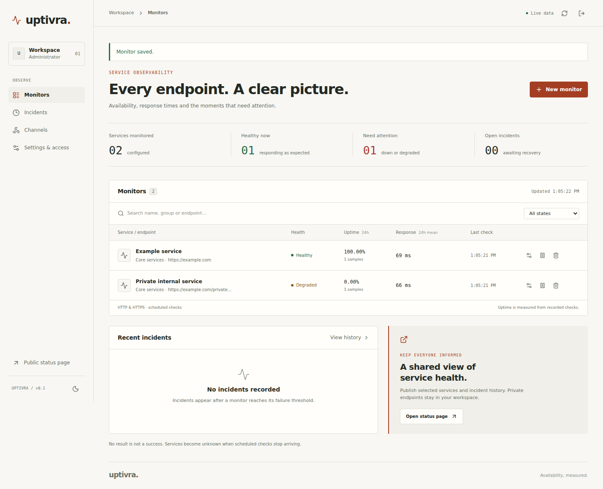
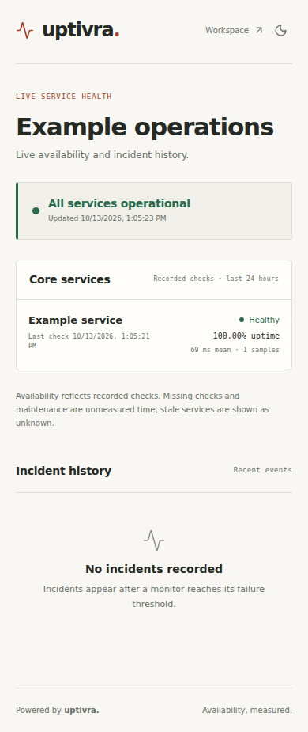
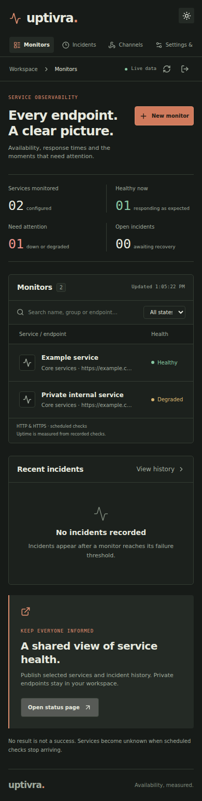
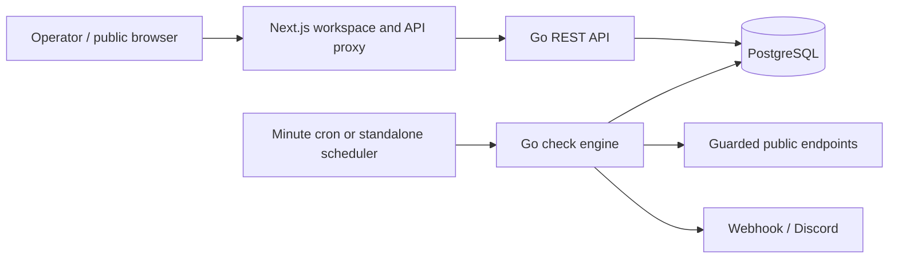

# uptivra.

Availability, measured.

Uptivra is a self-hostable uptime monitor for public HTTP and HTTPS services. A Go engine runs checks, records incidents and delivers alerts; a compact web workspace gives operators a clear view of service health. Publish selected monitors on a public status page or consume the API from an existing application.



<table><tr><td></td><td></td></tr></table>

These are screenshots of the running application, captured by its browser workflow against PostgreSQL. The example monitors are test fixtures with real outbound checks.

## What it does

- Configurable HTTP(S) GET checks: expected status, body substring, encrypted request headers, intervals and timeouts.
- Consecutive failure/recovery thresholds, automatic incident history, pause and maintenance controls.
- Measured 24-hour uptime, mean and p95 response times, recent check charts and history.
- Webhook and Discord alerts backed by a durable outbox, signed webhook payloads and bounded retries.
- One administrator, secure sessions, scoped API keys and an explicitly redacted public status API.
- Responsive light/dark workspace, public status page, SVG badge and small application integrations.
- PostgreSQL work claims that survive overlapping cron invocations and process restarts.

The current scope is one administrator, one public status page and public-network HTTP(S) endpoints on ports 80/443. TCP/DNS checks, TLS-expiry alerts, email, geographic probes, multiple users and status-page domains are future work. Private-network monitoring is deliberately blocked. There is no billing, audit log or alert replay interface.

## Run locally

Requires Docker Engine with Compose v2 or newer. For native Go/Node development, see [deployment](docs/deployment.md#native-development).

```sh
cp .env.example .env
openssl rand -hex 32       # POSTGRES_PASSWORD
openssl rand -base64 32    # ENCRYPTION_KEY
openssl rand -hex 32       # CRON_SECRET
```

Put those three independent values into `.env`; keep `APP_ORIGIN=http://localhost:3000`. Use a hex database password so the Compose connection URL needs no escaping. Then:

```sh
docker compose up --build -d
read -r -p 'Administrator email: ' ADMIN_EMAIL
read -r -s -p 'Administrator password (14–72 bytes): ' ADMIN_PASSWORD
printf '\n'
export ADMIN_EMAIL ADMIN_PASSWORD
docker compose run --rm -e ADMIN_EMAIL -e ADMIN_PASSWORD api bootstrap
unset ADMIN_EMAIL ADMIN_PASSWORD
```

Open **http://localhost:3000** and sign in. Public status is at **/status**. Create a monitor for an endpoint you are authorized to check; the scheduler runs immediately at startup and every minute afterward. Allow a subsequent minute for the first new monitor check.

Compose binds the web service to localhost. For a remote server, put a TLS reverse proxy in front of it and set `APP_ORIGIN` to that exact HTTPS origin. PostgreSQL and the Go API stay on the private Compose network. [Deployment instructions](docs/deployment.md) cover persistence, upgrades, native services and Vercel.

## Architecture

Go 1.27 · PostgreSQL 16 · Next.js 16 · React 19 · TypeScript · Apache-2.0



Business rules live in Go. PostgreSQL stores configuration, checks, incidents, hashed credentials, fenced leases and notification retries. The web service proxies authenticated requests to a fixed backend origin. No Redis, external job queue or permanent worker is required on Vercel. The same engine runs as a process, a scheduled CLI command or a Go Function.

The scheduler claims up to 32 checks and 16 notifications per invocation, with eight concurrent workers. It skips missed schedule slots and preserves cadence. Checks that stop arriving become unknown; gaps never count as successful observations. See [architecture and limits](docs/architecture.md).

## Deployment

- **Docker / VPS:** [Compose and systemd](docs/deployment.md). Migrations are explicit; PostgreSQL data is persisted in a named volume.
- **Vercel Pro:** [two-project deployment](docs/deployment.md#vercel-pro). The Go API uses the beta Go Functions runtime and authenticated minute cron; the frontend is a separate Next.js project. Go Functions are available across plans, but the supplied minute cron needs Pro or higher. See [Vercel cron limits](https://vercel.com/docs/cron-jobs/usage-and-pricing) and the [Go runtime](https://vercel.com/docs/functions/runtimes/go).
- **Other hosts:** run the Go binary plus the Next.js standalone server with a managed PostgreSQL database. Providers must support outbound public HTTP(S), the execution budget and a reliable minute scheduler. Compatibility beyond the documented paths has not been verified.

The Vercel Go adapter was compiled with the official builder, the production frontend was built and served, and Compose configuration was validated. A remote Vercel deployment and Docker container execution have not been performed in this development environment. Verify those in your hosting account before relying on alerts. [Operations](docs/operations.md) includes acceptance checks, coverage monitoring and backups.

## API and integrations

[OpenAPI 3.1](docs/openapi.json) · [Integration guide](docs/integrations.md) · [Next.js](examples/nextjs/service-health.tsx) · [Laravel/PHP](examples/laravel/service-health.blade.php) · [Go](examples/go/main.go)

Public status and badges need no credentials. Scoped keys let a server read status/configuration or manage monitors without adopting Uptivra's frontend or database. API keys stay server-side. Outgoing webhooks carry incident events with HMAC authentication and stable delivery IDs.

## Configuration and security

[Environment reference](docs/deployment.md#environment) · [Security policy](SECURITY.md) · [Threat model](docs/security.md)

Network checks reject internal, loopback, link-local, metadata and reserved destinations. DNS answers are checked and the validated address is pinned when connecting; redirects pass the same checks. Sessions are HttpOnly, CSRF checks are enforced on cookie mutations, passwords use bcrypt, and sensitive outbound configuration uses authenticated encryption. Public DTOs omit targets and secrets. These controls have regression tests; they do not replace infrastructure isolation or secure operational practices.

## Development and verification

Install Go 1.27.2, Node 24.11 and PostgreSQL 16. Keep dependency versions pinned and use the lockfile.

```sh
go mod download
npm --prefix web ci
# A disposable database; the role needs permission to create schemas.
export TEST_DATABASE_URL='postgres://localhost/uptivra_test?sslmode=disable'
go test -race ./...
go vet ./...
go mod verify
go run golang.org/x/vuln/cmd/govulncheck@v1.9.0 ./...
npm --prefix web run format:check
npm --prefix web run typecheck
npm --prefix web run build
npm --prefix web audit --audit-level=moderate
```

Database tests skip if `TEST_DATABASE_URL` is missing. They create isolated schemas and remove them afterward. CI always supplies a real PostgreSQL service. The browser workflow uses a separate running, bootstrapped instance and makes real outbound requests to `example.com`; see [contributing](CONTRIBUTING.md) for its setup. Test availability depends on public DNS/HTTPS access.

[Contributions](CONTRIBUTING.md) are welcome. Please follow the [code of conduct](CODE_OF_CONDUCT.md) and report vulnerabilities privately through [SECURITY.md](SECURITY.md).

Licensed under [Apache-2.0](LICENSE). Maintained by [timmsy1998](https://github.com/timmsy1998).
